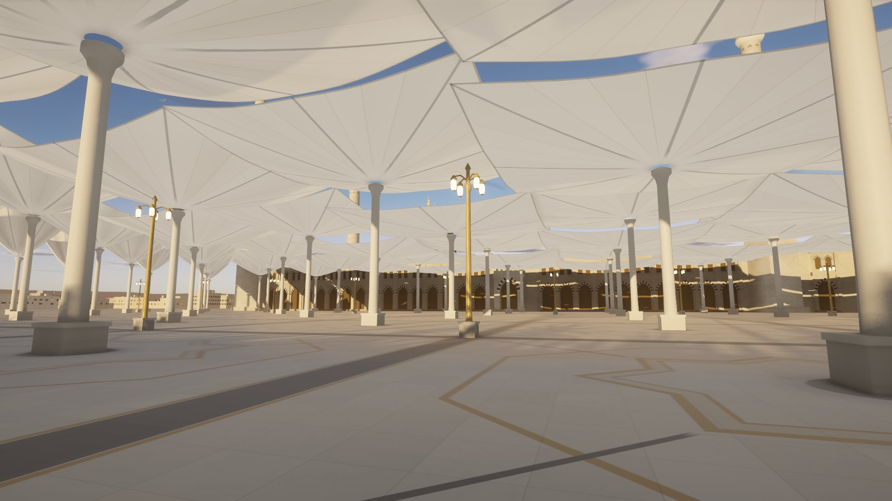
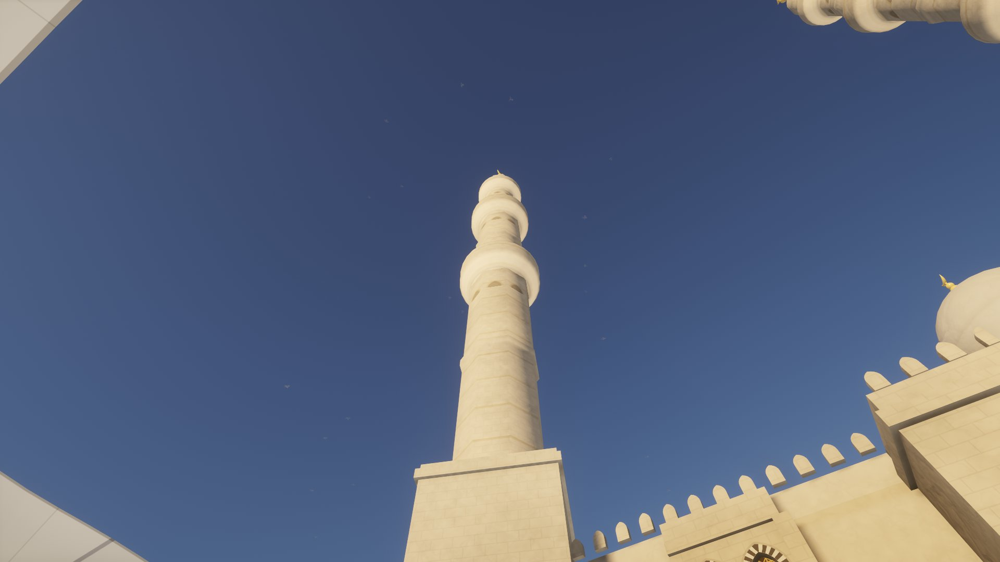
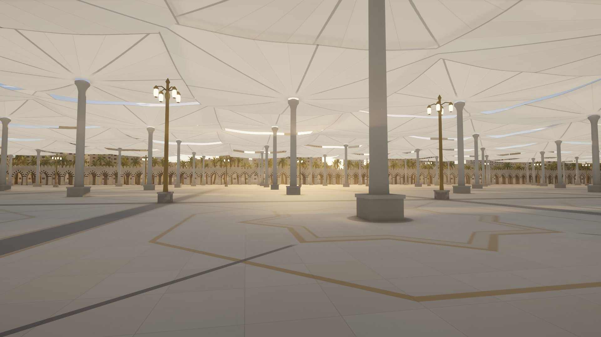
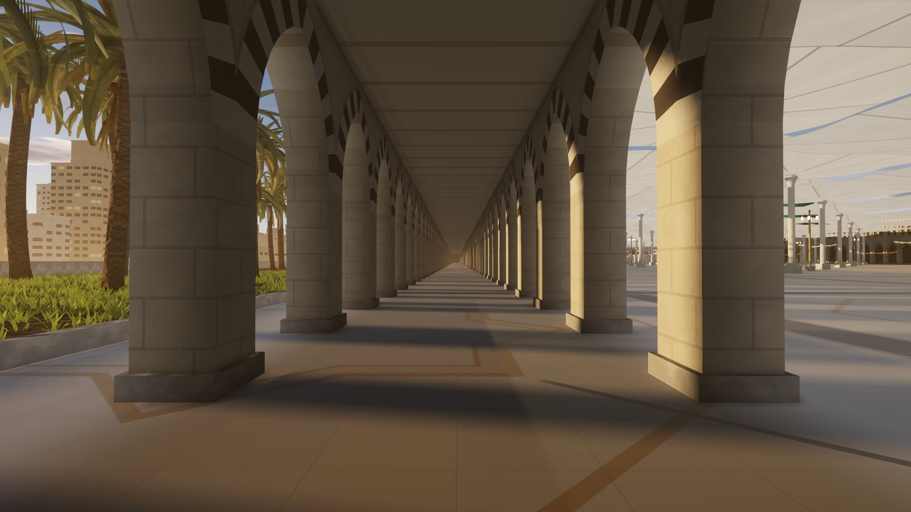
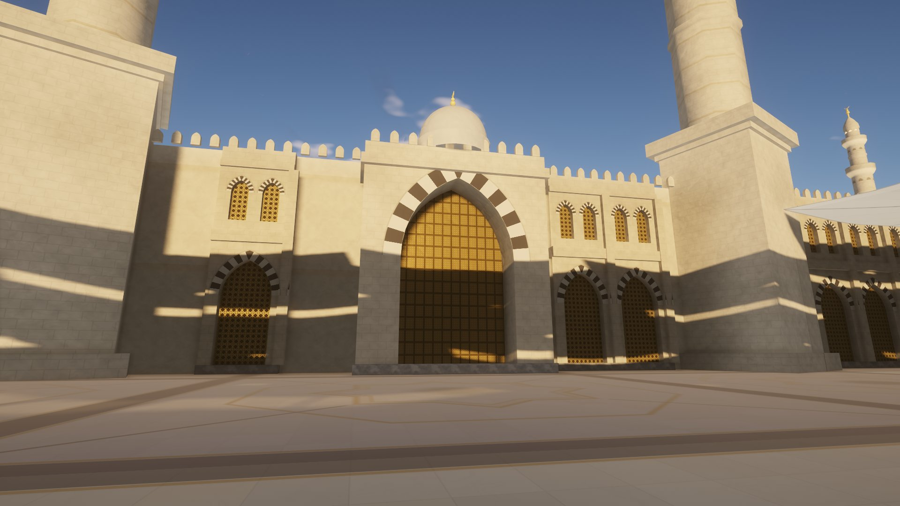
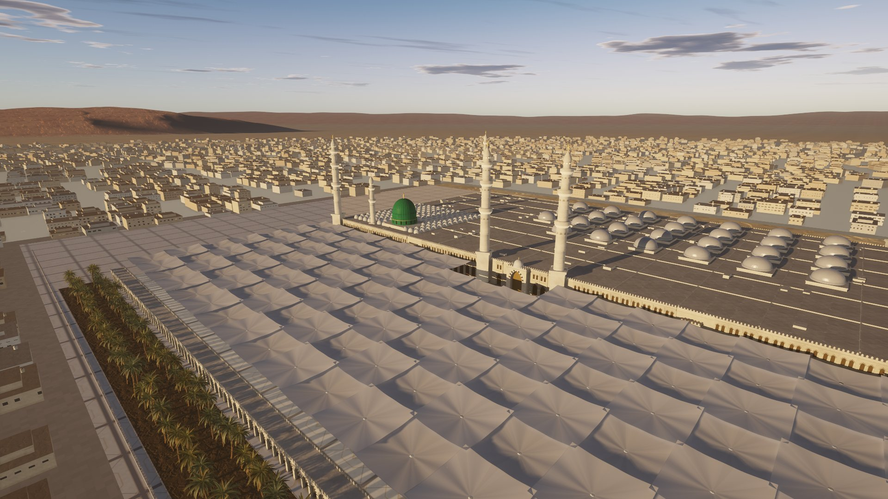

# Nabawi Courtyard

<p align="center">
  <a href="https://moeymakes.github.io/masjid-nabawi-courtyard/"></a>
</p>
<p align="center"><b><a href="https://moeymakes.github.io/masjid-nabawi-courtyard/">moeymakes.github.io/masjid-nabawi-courtyard/</a></b><br>
<sub>Chrome or Edge on a desktop or laptop (needs WebGPU) · nothing to install · one HTML file</sub></p>

**Walk the marble plaza of the Prophet's Mosque in Madinah just after sunrise, right in your browser, and watch
the great umbrellas open.**

White marble underfoot with grey and sand-coloured inlay, rows of tall white columns whose umbrellas unfold one
after another, the mosque's pale facade with its pointed arches and closed brass gates, minarets about 100 m
tall, silver domes on the roof and the Green Dome rising above it. Everything is made by code: no images, no 3D
models, no sound files. The whole world is **one HTML file** of about 93 KB (38 KB gzipped).

The buildings are respectful approximations, not replicas, and the distances are composed so everything fits in
a walk. There are no people in the scene, nothing inside the mosque is shown, and nothing is recited.

[](https://moeymakes.github.io/masjid-nabawi-courtyard/)

| | |
|---|---|
|  |  |
|  |  |



## Try it

1. Open **[https://moeymakes.github.io/masjid-nabawi-courtyard/](https://moeymakes.github.io/masjid-nabawi-courtyard/)** in **Chrome** or **Edge** on a desktop computer, or download
   [`index.html`](index.html) and open it from your computer (it works offline).
3. Wait a few seconds while the plaza is built, then press **Enter** and start walking. The umbrellas begin to
   open about three seconds later, spreading out from the main gate (or pick **Open** in the menu).

It works offline. It needs a browser with **WebGPU**.

## What's there

- **The umbrellas**: a hundred white tensile canopies, 25.5 m across, on tall columns. They stand closed as slim
  buds and open slowly, one after another; their fabric glows when the low sun is behind it. Press `U` to close
  and reopen them.
- **The floor**: polished white marble slabs with grey border bands, sand-coloured pinstripes and an
  eight-pointed star around every column, faintly mirroring the facade and the canopies
- **The east facade**: blind pointed arches with black-and-white voussoirs and brass lattice screens, three gate
  portals with closed brass doors and lanterns still glowing from the night
- **Minarets** with corbelled balconies and gold crescent finials, the **silver roof domes**, the **Green Dome**
  above the old mosque, and an older minaret beside it
- **An arcade** of pointed arches along the plaza's east edge, with date palms and a planted bed behind it
- **Lamp posts** with four lanterns each, **pigeons** circling, dust drifting in the low sun
- **Sound** made up as you listen: wind, pigeons cooing and clapping their wings, sparrows, palms rustling

## Controls

| | Keyboard & mouse |
|---|---|
| Look around | Move the mouse (or drag with the left button where the mouse cannot be captured) |
| Walk | `W` `A` `S` `D` |
| Run | Hold `Shift` |
| Fly / walk | `F`, or `E` to lift off from walking |
| Up / down | `E` / `Q` (descending onto the ground lands you back to walking) |
| Close and reopen the umbrellas | `U` |
| Umbrellas at the start | **Opening** (they open a few seconds after you enter, about 20 s for the whole wave), **Open** or **Closed** in the menu |
| Jump to a viewpoint | `1` to `6` |
| Menu | `Esc` |
| Sound on / off | `M` |
| Performance stats | `H` |
| Detail level | **Low**, **Medium** or **High** in the menu (reloads the page) |

**On a touchscreen:** hold one finger down to walk forward and slide it to look around; a second finger runs;
the ✈ button toggles flight.

## How it works

- The umbrellas are drawn by one shader: each one is a grid of fabric points that the graphics card folds into
  a bud or spreads into a canopy from a single clock, so the whole field opens without any work on the page.
  While they move, their shadows are redrawn every other frame.
- The marble pattern is computed per pixel from the floor position, with every line filtered to the pixel's
  footprint so it stays clean in the distance. The floor's reflection of the facade and canopies is worked out
  from simple shapes rather than by drawing the scene twice.
- The facade, arcade, minarets and domes are built from a few mesh shapes (arch panels, lathes, boxes) when the
  page opens; the surroundings out to 12 km come from one ground function evaluated on the graphics card.
- Everything is drawn with **WebGPU** directly. No engine or 3D library.
- The method, the verification loop and the page structure follow
  [Abyssal Garden](https://github.com/noniv/abyssal-garden) (MIT), via the `worldsmith` skill, by way of the
  sibling world Madinah Horizon.

## Make it your own

Source is in [`source`](source). Rebuild with Node.js 18+:

```bash
cd source && npm install && npm run build
```

| File | What's inside |
|---|---|
| [`source/src/world.js`](source/src/world.js) | Layout: the facade, gates, minarets, domes, umbrellas, lamps, arcade, palms, city, viewpoints and the camera path |
| [`source/src/shaders.js`](source/src/shaders.js) | Sky and haze, the marble, stone, brass and dome materials, the umbrella membranes, fronds, sun shafts and the final image |
| [`source/src/main.js`](source/src/main.js) | Renderer, the umbrella clock, walking and flying, collision, controls |
| [`source/src/audio.js`](source/src/audio.js) | The soundscape |
| [`source/src/quality.js`](source/src/quality.js) | Detail levels |
| [`source/template.html`](source/template.html) | The page: loading bar, menu, controls list |

`npm run build:dev` writes `dev.html` with a scripted one-minute flight (`P`) and a benchmark (`B`).

## Other worlds in this series

- **[Madinah Horizon](https://moeymakes.github.io/madinah-horizon/)**: the date gardens, lava fields and hills around Madinah at golden hour, with the Prophet's Mosque and Uhud on the horizon ([source](https://github.com/moeymakes/madinah-horizon))
- **[Madinah, First Years](https://moeymakes.github.io/madinah-first-years/)**: the oasis and the first mosque around 622-632 CE, an artistic reconstruction ([source](https://github.com/moeymakes/madinah-first-years))

## License

MIT. Parts adapted from Abyssal Garden (MIT); its notice is in `source/LICENSE-abyssal-garden`.
